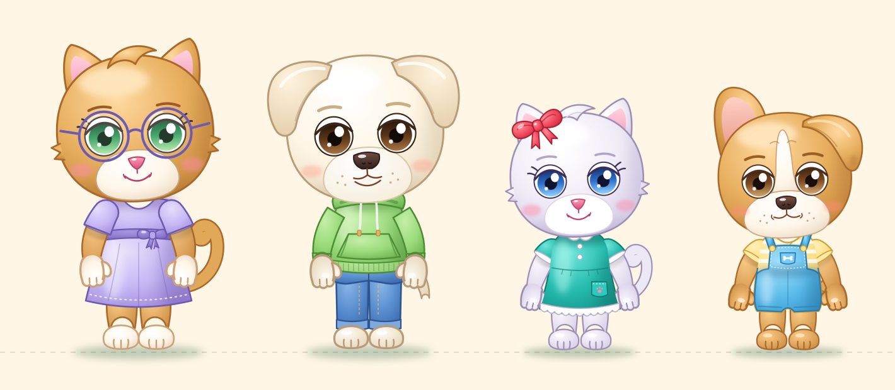

# Characters — art direction

Shared visual reference for every character in Elide's Family.
Every sheet in this folder follows these rules: what changes is the character's identity, not the style.

> Status: **design approved** (2026-11-13, D-046). Shapes, colors and poses are the working base; the final rendering will be refined.

## Style

- Soft, sweet and cheerful cartoon style, with volumes rendered by soft shading.
- **Colored outlines**: every outline is a darker version of the color it surrounds (dark lilac on white fur, dark teal on the turquoise dress, dark pink on nose and mouth). Never a flat black.
- Few inner lines: eyes, mouth, a few clothing details.
- Light from the top left, soft lilac shadows, small glossy highlights.
- Not allowed: realism, anime style, flat 2D.

## Proportions

- The head is about half of the total height, round and full.
- Round eyes set wide apart (about one eye apart), colored eyebrows.
- Large light muzzle in the lower part of the face, little nose on top, simple smile.
- Chubby arms and legs, thicker at the root; little hands with a thumb and three fingers, feet with toes.
- Hands follow their **handedness** (D-051): with the palm shown and the fingers up (wave, cheer, surprised) the thumb points **towards the body**; at rest, arm hanging and back of the hand to the viewer, the thumb is also towards the body; with the back shown and the fingers up it points outwards.
- Hands and feet are **one piece with the limbs**: no outline at the wrist or ankle, only the outer silhouette is outlined (lines stay only inside: thumb against palm, fingers, toes).
- **Shoulders** are part of the torso: gently sloping and narrow (delicate, not athletic), and the sleeve continues the torso outline with no break (D-053).
- In every pose the arms must stay **visible**: raised arms go beside the head, not behind it; a forearm that comes back to the face or the chest crosses in front of its own upper arm and sleeve.
- Sleeves follow the arm in every pose: the arm comes out of the sleeve with a soft shadow, without a visible joint.
- Kids (Elide, Rio) and adults (Dad, Mom) have the same head: the body is what changes.
- Right and left are always meant **from the character's point of view**.
- In scenes the kids (Elide, Rio) are drawn at **85%** of the adults, so Mom and Dad are immediately recognized as grown-ups.

## Eyes

- Large iris, dark at the top and light at the bottom; large pupil; a big highlight at the top right and a small one at the bottom left.
- Thick upper eyelid; eyelashes only for the female characters.
- When smiling, the cheeks rise and close the eye from below.

## Expressions and poses

Every character has at least these states, built from the same model (only arms, eyes, eyebrows, mouth and tilt change):
idle, hi, hooray, curious, surprised, well done.

## Animation suite (D-033)

Every character has the **complete suite**, the same for everyone. It is organized in **separate layers** (body, face, eyes, mouth) that combine: for example Elide can walk, talk and smile at the same time. All transitions are interpolated, with no jerks. The animations are driven by code (D-039).

| Group | Animations |
|-------|------------|
| **Idle** | Breathing, blinking, looking around, waiting after a while without input (yawning, swaying), sitting |
| **Movement** | Walking (front and side), running, turning around, entering and leaving the scene, jumping on the spot, jumping forward with a soft landing |
| **Happiness** | Smile, happy hop, hooray with raised arms, clapping, laughing, thumbs up, little heart / hug |
| **Dances** | At least 3 different looping dances (swaying, twirl, clapping to the beat) |
| **Gentle disapproval** | Shaking the head "no", wagging finger, pout, crossed arms, disappointed shoulders, slightly sad face |
| **Thinking and surprise** | Curiosity (hand on the chin), confusion (scratching the head), surprise, small funny fright |
| **Interaction** | Waving, beckoning, pointing right and left, taking and handing over an object, reaction to touch (tickles, giggle) |
| **Routines** | Eating, drinking, washing, yawning and sleeping |
| **Speech** | Viseme lip sync for the TTS voices: rest, A, E, I, O, U, M-B-P, F-V |

Disapproval is always sweet and funny, never punishing or scary: it means "let's try again", not "you got it wrong".

## Sheets

| Character | Status | Sheet |
|-----------|--------|-------|
| Elide | Draft provisionally approved | [elide.md](elide/elide.md) |
| Rio | Draft provisionally approved | [rio.md](rio/rio.md) |
| Dad (Papà) | Draft provisionally approved | [dad.md](dad/dad.md) |
| Mom (Mamma) | Draft provisionally approved | [mom.md](mom/mom.md) |

The draft images are generated by `tools/character-drafts/` (`elide.py`, `rio.py`, `dad.py`, `mom.py`): each script writes an SVG, which is converted to PNG with `parts.py` (librsvg). Shared hands, arms and sleeves live in `parts.py`.

```bash
cd tools/character-drafts
python3 elide.py /tmp/elide_poses.svg && python3 parts.py /tmp/elide_poses.svg ../../docs/characters/elide/elide_poses.png
python3 elide.py /tmp/elide_model.svg single && python3 parts.py /tmp/elide_model.svg ../../docs/characters/elide/elide_model.png
python3 group.py ../../docs/characters/group.png
```

### Animation rig (D-050)

The game does not use the sheets: `export_rig.py` turns the same draft code into the parts the game animates.

```bash
cd tools/character-drafts
python3 export_rig.py elide   # PNG layers in assets/images/characters/elide/, rig in assets/animations/char_elide_rig.json
```

The poses live in `POSE_DATA` inside each draft script, so a pose changed there changes both the sheet and the game. After changing a draft, regenerate the sheet **and** the rig.

## Group sheet



Mom · Dad · Elide · Rio, on the same ground line and with the kids at 85%. Generated by `tools/character-drafts/group.py`.
