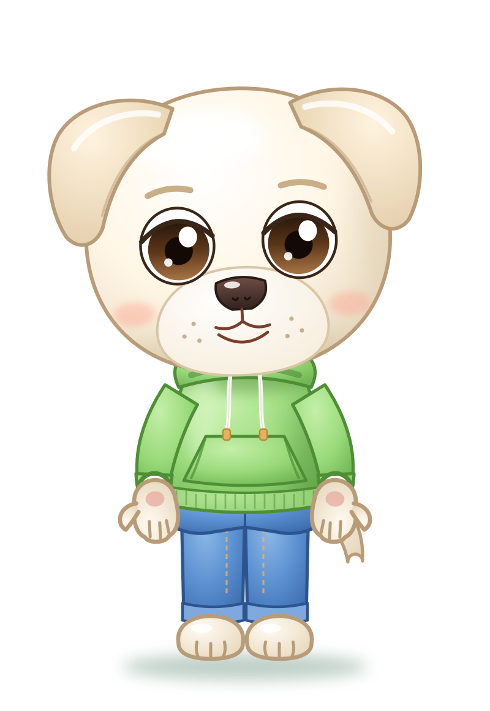
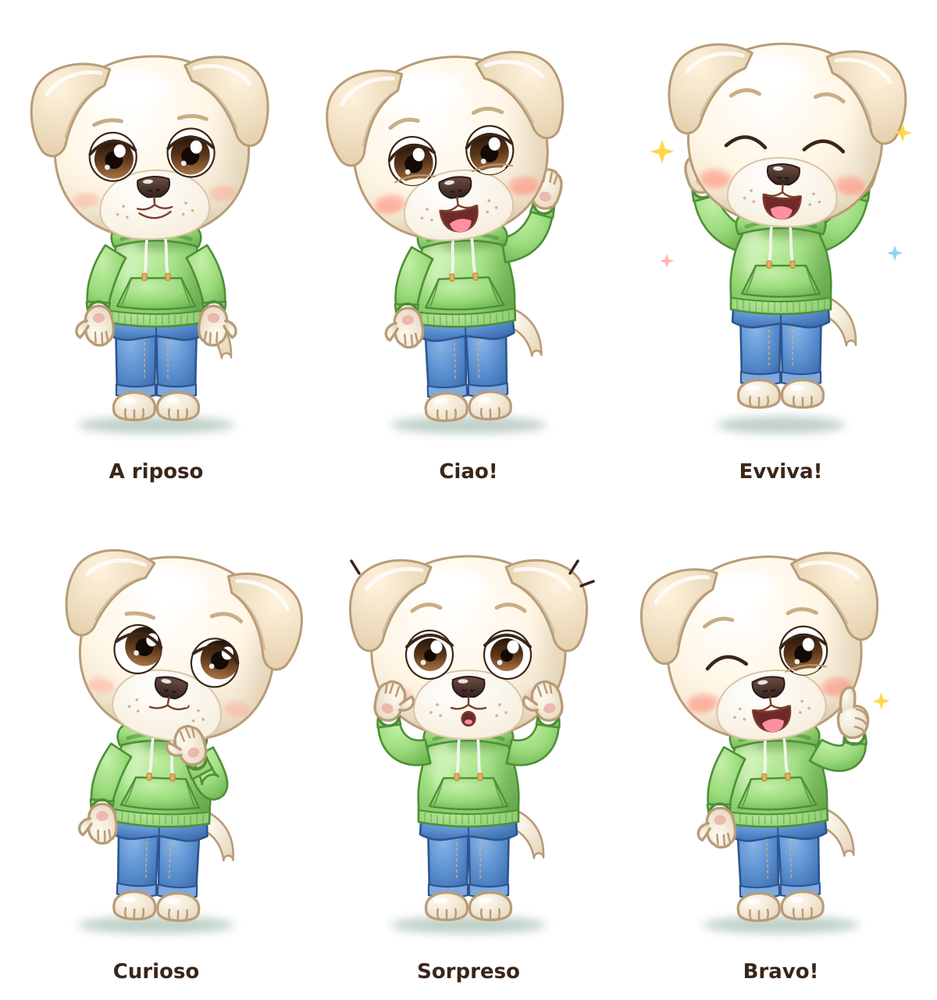

# Dad (Papà) — character sheet

> Draft provisionally approved on 2026-11-12. To be refined later.

| | |
|---|---|
| **Species and role** | White Labrador, Elide's dad. He stands on two legs and has the same head as the kids. |
| **Build** | Not tall and a bit chubby, with a soft tummy: just slightly taller than the kids, with a wider torso and fuller arms. |
| **Main color** | Warm white with sand shadows; beige outlines (`#B89C78`). |
| **Head** | Round and full, like Elide's and Rio's. |
| **Ears** | Soft Labrador ears, **slightly raised**: they move nicely in animations. A little darker than the fur. |
| **Eyes** | Dark brown, round and set wide apart; iris dark at the top and light at the bottom; thick upper eyelid, **no eyelashes**; beige eyebrows. |
| **Muzzle** | Large and light, big dark shiny nose, soft upper lip, whisker dots, rosy cheeks. When he laughs he shows his little tongue. |
| **Tail** | Labrador tail: thick at the root, tapering and hanging down. |
| **Limbs** | Little hands with a thumb, three fingers and a pink pad; feet with toes. Barefoot. |
| **Clothing** | Plain **meadow-green** hoodie with the hood resting on the shoulders, white drawstrings with golden tips, kangaroo pocket, ribbed cuffs and hem. Blue jeans with golden seams and a rolled-up hem. |
| **Accessories** | None: he is recognized by his build and clothes. |
| **Recognizable by** | Green hoodie, jeans, soft raised ears, tummy. |

## Palette

| Use | Color |
|-----|-------|
| Fur light / base / shadow | `#FFFFFF` / `#FFF6E5` / `#E9DCC4` |
| Ears | `#FFF3DE` → `#E2CCA8` |
| Fur outline | `#B89C78` |
| Iris (top → bottom) | `#24140A` → `#5A3518` → `#A87444` |
| Nose | `#6E4E44` → `#33221E` |
| Hoodie light / base / shadow | `#C4EFA8` / `#9BDB7C` / `#6FB552` |
| Ribbing | `#B2E594` → `#7FC262` |
| Hoodie outline | `#4E8F36` |
| Jeans light / base / shadow | `#8CB8E8` / `#5A8FD0` / `#3C6CAE` |
| Jeans outline | `#2C5590` |

## Poses and expressions

Idle · Hi! · Hooray! · Curious · Surprised · Well done!
