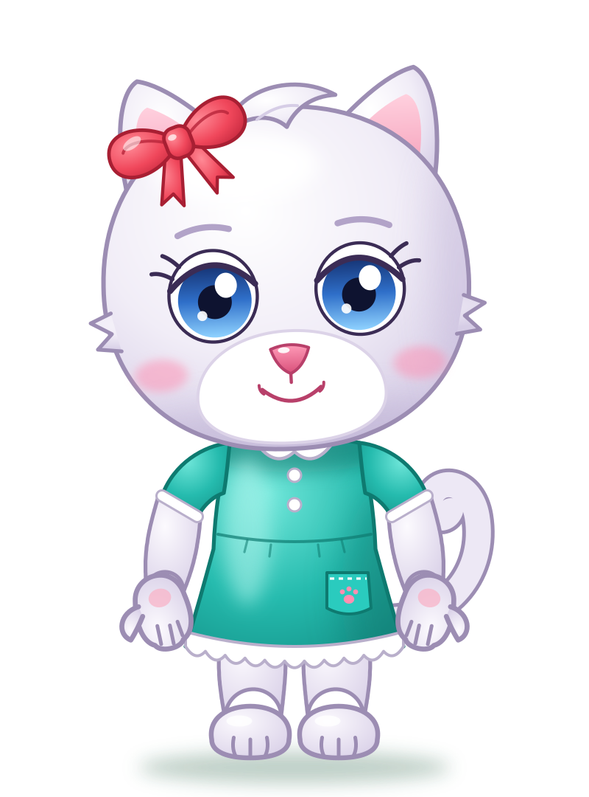

# Elide — scheda personaggio

> Bozza approvata provvisoriamente il 2026-11-12. Da ottimizzare in seguito.

| | |
|---|---|
| **Specie e ruolo** | Gattina bianca, la più piccola di casa. Protagonista: presente in tutti i minigiochi. |
| **Personalità** | Curiosa, coraggiosa, affettuosa. Quando è contenta saltella sul posto. |
| **Colore dominante** | Bianco lilla con ombre lilla; contorni lilla scuro (`#9C8DB3`). |
| **Testa** | Rotonda e piena, ciuffetti di pelo ai lati, ciuffo morbido pettinato di lato in cima. |
| **Occhi** | Azzurri, rotondi e distanziati; iride scura in alto e chiara in basso; palpebra spessa, due ciglia; sopracciglia lilla. |
| **Musetto** | Grande e bianco nella parte bassa del viso, nasino rosa lucido, sorriso semplice, guance rosate. |
| **Orecchie e coda** | Orecchie a punta con interno rosa; coda arricciata. |
| **Arti** | Braccia paffute con gomito, manine con pollice e tre ditine e cuscinetto rosa; gambe piene, piedi con le dita. |
| **Abbigliamento** | Vestitino turchese a maniche corte: colletto e polsini bianchi, due bottoncini, cucitura in vita, taschino con zampetta rosa ricamata, orlo smerlato bianco. A piedi nudi. |
| **Accessorio** | Grande fiocco rosso fragola sull'orecchio destro di Elide (a sinistra di chi guarda), con nodo e due codine. |
| **Riconoscibile da** | Fiocco rosso, ciuffo di lato, occhi azzurri, coda arricciata. |

## Palette

| Uso | Colore |
|-----|--------|
| Pelo luce / base / ombra | `#FFFFFF` / `#F1EDF7` / `#D6CDE6` |
| Contorno pelo | `#9C8DB3` |
| Iride (alto → basso) | `#14306F` → `#2F6FC9` → `#8FD2FF` |
| Vestito luce / base / ombra | `#6FE6D9` / `#25BBAE` / `#15948A` |
| Contorno vestito | `#0E7A70` |
| Fiocco | `#FF8A96` → `#F0475B` → `#C92A40` |
| Naso, interno orecchie | `#FF9BB8` / `#F49DB8` |

## Pose ed espressioni

A riposo · Ciao! · Evviva! · Curiosa · Sorpresa · Brava!
