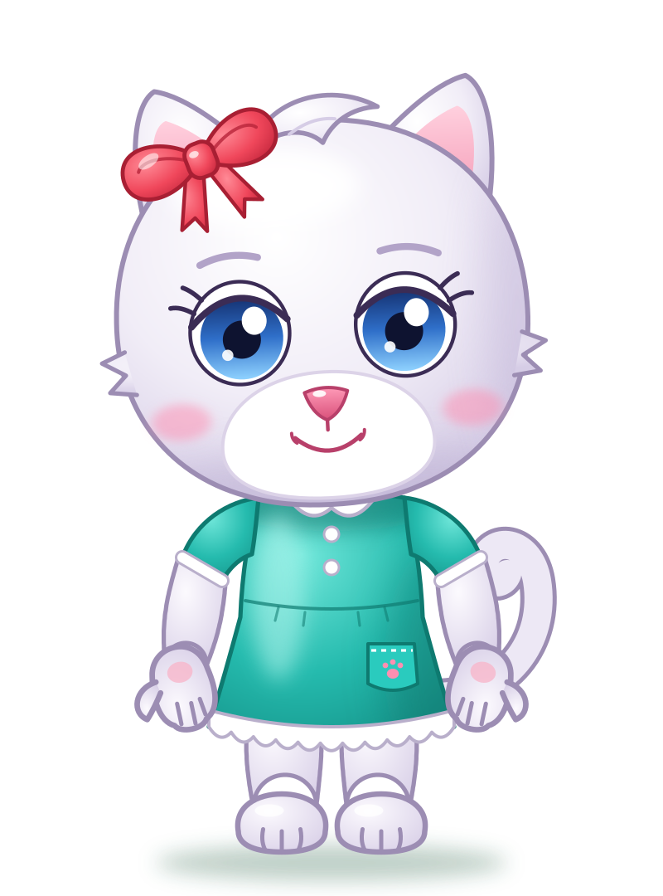
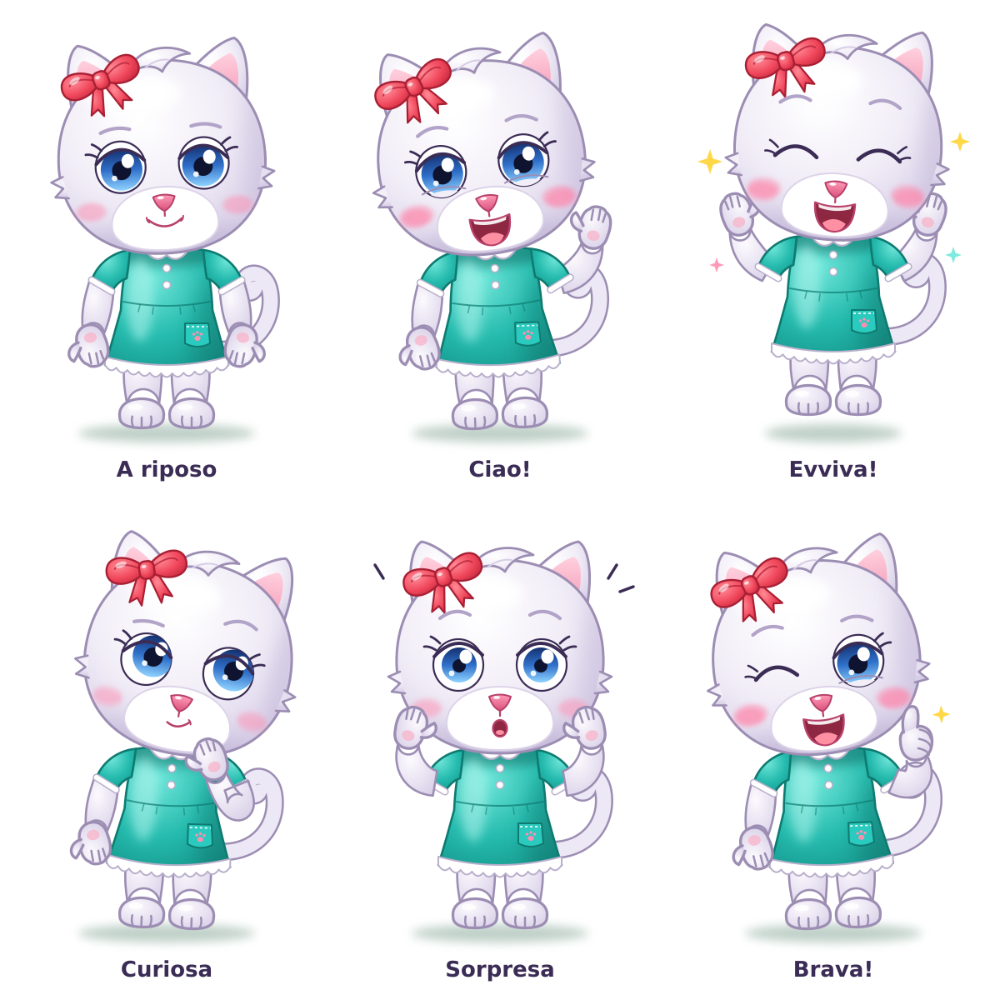

# Elide — character sheet

> Draft provisionally approved on 2026-11-12. To be refined later.

| | |
|---|---|
| **Species and role** | White kitten, the youngest in the family. The protagonist: she appears in every minigame. |
| **Personality** | Curious, brave, affectionate. When she is happy she hops on the spot. |
| **Main color** | Lilac white with lilac shadows; dark lilac outlines (`#9C8DB3`). |
| **Head** | Round and full, small fur tufts on the sides, a soft side-swept tuft on top. |
| **Eyes** | Light blue, round and set wide apart; iris dark at the top and light at the bottom; thick upper eyelid, two eyelashes; lilac eyebrows. |
| **Muzzle** | Large and white in the lower part of the face, glossy pink little nose, simple smile, rosy cheeks. |
| **Ears and tail** | Pointed ears with a pink inside; curled tail. |
| **Limbs** | Chubby arms with an elbow, little hands with a thumb, three fingers and a pink pad; full legs, feet with toes. |
| **Clothing** | Short-sleeved turquoise dress: white collar and cuffs, two small buttons, waist seam, small pocket with an embroidered pink paw, white scalloped hem. Barefoot. |
| **Accessory** | Big strawberry-red bow on Elide's right ear (the viewer's left), with a knot and two tails. |
| **Recognizable by** | Red bow, side tuft, light blue eyes, curled tail. |

## Palette

| Use | Color |
|-----|-------|
| Fur light / base / shadow | `#FFFFFF` / `#F1EDF7` / `#D6CDE6` |
| Fur outline | `#9C8DB3` |
| Iris (top → bottom) | `#14306F` → `#2F6FC9` → `#8FD2FF` |
| Dress light / base / shadow | `#6FE6D9` / `#25BBAE` / `#15948A` |
| Dress outline | `#0E7A70` |
| Bow | `#FF8A96` → `#F0475B` → `#C92A40` |
| Nose, inner ears | `#FF9BB8` / `#F49DB8` |

## Poses and expressions

Idle · Hi! · Hooray! · Curious · Surprised · Well done!
