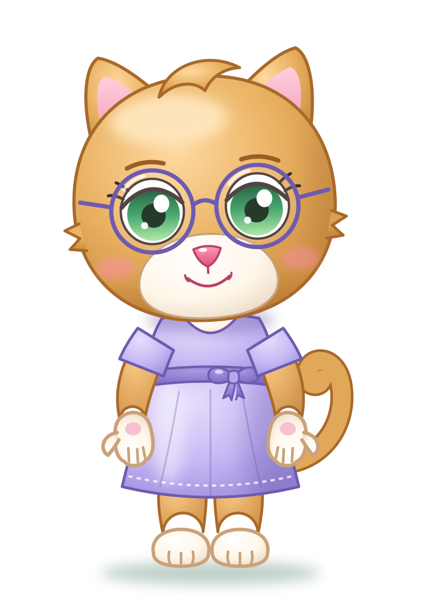
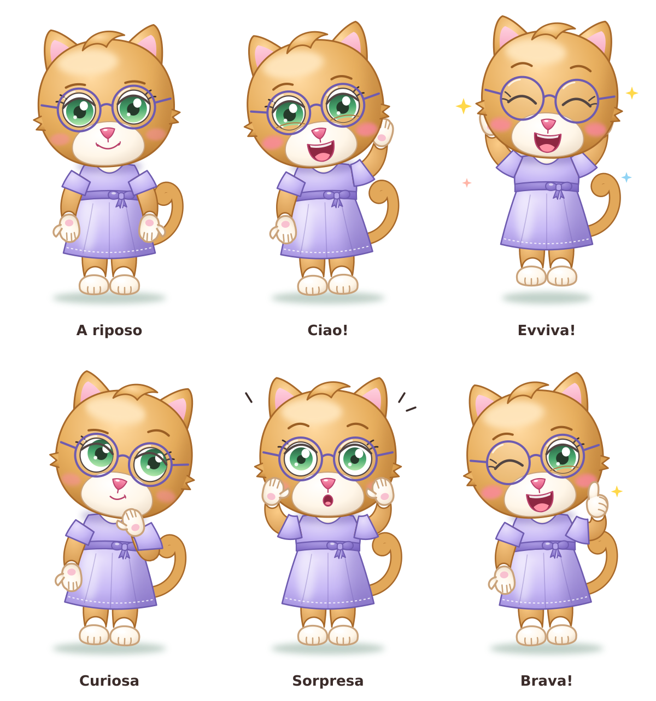

# Mamma — scheda personaggio

> Bozza approvata provvisoriamente il 2026-11-12. Da ottimizzare in seguito.

| | |
|---|---|
| **Specie e ruolo** | Gatta color miele con macchie bianche, la mamma di Elide. In piedi su due zampe, con la stessa testa dei piccoli. |
| **Corporatura** | Come Papà: non alta e un po' morbida. |
| **Colore dominante** | Miele con ombre ambrate; contorni miele scuro (`#A8692A`). |
| **Macchie bianche** | Musetto, petto (visibile nello scollo) e zampe: mani e piedi bianchi. |
| **Testa** | Rotonda e piena, ciuffetti di pelo ai lati, ciuffo morbido pettinato di lato in cima (come Elide). |
| **Orecchie e coda** | Orecchie a punta con interno rosa; coda arricciata. |
| **Occhi** | **Verdi**, rotondi e distanziati; iride scura in alto e chiara in basso; palpebra spessa, due ciglia; sopracciglia miele scuro. |
| **Accessorio** | **Occhiali tondi** con montatura sottile lavanda scuro. |
| **Musetto** | Grande e bianco, nasino rosa lucido, sorriso semplice, guance rosate. |
| **Abbigliamento** | Vestito **lavanda** al ginocchio: maniche corte a sbuffo, corpetto, cintura in vita con fiocchetto, gonna a campana con orlo cucito. A piedi nudi. |
| **Riconoscibile da** | Occhiali tondi, vestito lavanda, zampe bianche, occhi verdi. |

## Palette

| Uso | Colore |
|-----|--------|
| Pelo luce / base / ombra | `#FFD9A0` / `#E8B060` / `#C98A3E` |
| Contorno pelo | `#A8692A` |
| Macchie bianche luce / base / ombra | `#FFFFFF` / `#FFF6E8` / `#EAD9C4` |
| Contorno macchie bianche | `#C9A27A` |
| Iride (alto → basso) | `#0F4A2A` → `#2E9B5A` → `#A8E6A0` |
| Vestito luce / base / ombra | `#E6DDFB` / `#C7B8F5` / `#9E8BDB` |
| Cintura e fiocchetto | `#A897E0` → `#7A64C2` |
| Contorno vestito e montatura occhiali | `#6E5BB0` |
| Naso, interno orecchie | `#FF9BB8` / `#F49DB8` |

## Pose ed espressioni

A riposo · Ciao! · Evviva! · Curiosa · Sorpresa · Brava!
