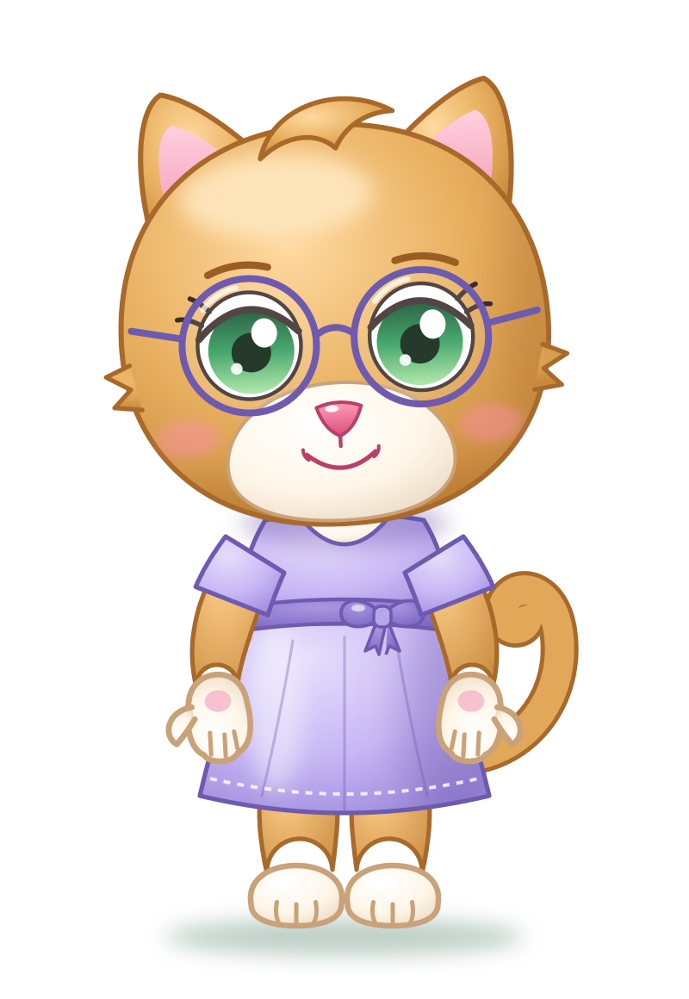
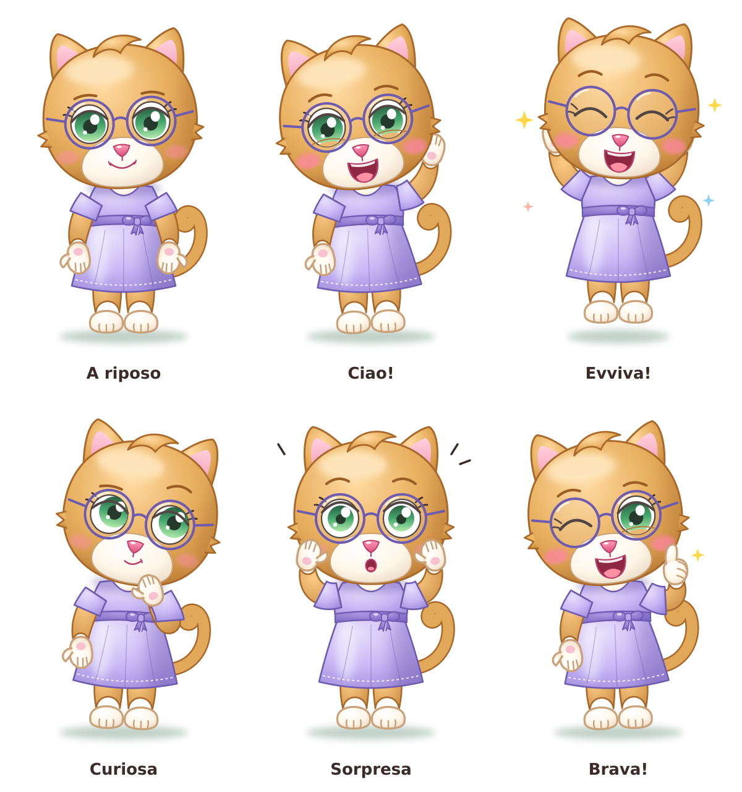

# Mom (Mamma) — character sheet

> Draft provisionally approved on 2026-11-12. To be refined later.

| | |
|---|---|
| **Species and role** | Honey-colored cat with white patches, Elide's mom. She stands on two legs and has the same head as the kids. |
| **Build** | Like Dad: not tall and a bit soft. |
| **Main color** | Honey with amber shadows; dark honey outlines (`#A8692A`). |
| **White patches** | Muzzle, chest (visible in the neckline) and paws: white hands and feet. |
| **Head** | Round and full, small fur tufts on the sides, a soft side-swept tuft on top (like Elide). |
| **Ears and tail** | Pointed ears with a pink inside; curled tail. |
| **Eyes** | **Green**, round and set wide apart; iris dark at the top and light at the bottom; thick upper eyelid, two eyelashes; dark honey eyebrows. |
| **Accessory** | **Round glasses** with a thin dark-lavender frame. |
| **Muzzle** | Large and white, glossy pink little nose, simple smile, rosy cheeks. |
| **Clothing** | Knee-length **lavender** dress: short puff sleeves, bodice, belt with a little bow at the waist, bell skirt with a stitched hem. Barefoot. |
| **Recognizable by** | Round glasses, lavender dress, white paws, green eyes. |

## Palette

| Use | Color |
|-----|-------|
| Fur light / base / shadow | `#FFD9A0` / `#E8B060` / `#C98A3E` |
| Fur outline | `#A8692A` |
| White patches light / base / shadow | `#FFFFFF` / `#FFF6E8` / `#EAD9C4` |
| White patches outline | `#C9A27A` |
| Iris (top → bottom) | `#0F4A2A` → `#2E9B5A` → `#A8E6A0` |
| Dress light / base / shadow | `#E6DDFB` / `#C7B8F5` / `#9E8BDB` |
| Belt and bow | `#A897E0` → `#7A64C2` |
| Dress outline and glasses frame | `#6E5BB0` |
| Nose, inner ears | `#FF9BB8` / `#F49DB8` |

## Poses and expressions

Idle · Hi! · Hooray! · Curious · Surprised · Well done!
