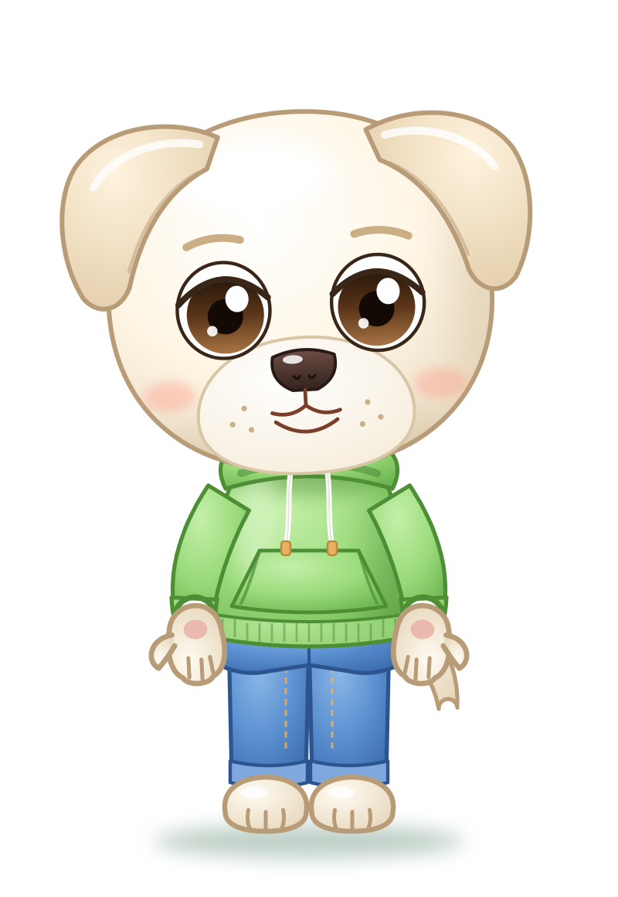
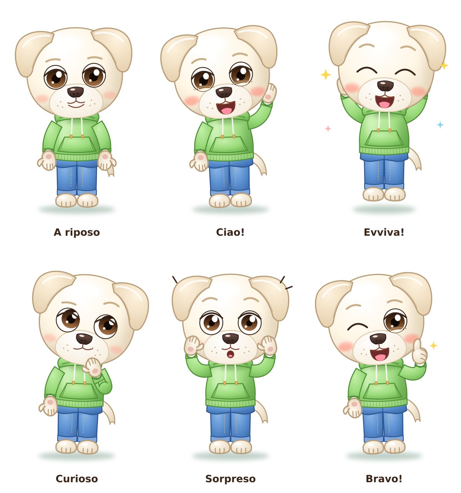

# Papà — scheda personaggio

> Bozza approvata provvisoriamente il 2026-11-12. Da ottimizzare in seguito.

| | |
|---|---|
| **Specie e ruolo** | Labrador bianco, il papà di Elide. In piedi su due zampe, con la stessa testa dei piccoli. |
| **Corporatura** | Non alto e un po' in carne, con la pancetta morbida: appena più alto dei piccoli, busto più largo e braccia più piene. |
| **Colore dominante** | Bianco caldo con ombre sabbia; contorni beige (`#B89C78`). |
| **Testa** | Rotonda e piena, come quella di Elide e Rio. |
| **Orecchie** | Morbide da labrador, **un po' sollevate**: si muovono bene nelle animazioni. Leggermente più scure del pelo. |
| **Occhi** | Marrone scuro, rotondi e distanziati; iride scura in alto e chiara in basso; palpebra spessa, **niente ciglia**; sopracciglia beige. |
| **Musetto** | Grande e chiaro, nasone scuro e lucido, labbro superiore morbido, puntini dei baffi, guance rosate. Quando ride mostra la linguetta. |
| **Coda** | Da labrador: spessa alla radice, si assottiglia e pende verso il basso. |
| **Arti** | Manine con pollice e tre ditine e cuscinetto rosa; piedi con le dita. A piedi nudi. |
| **Abbigliamento** | Felpa liscia **verde prato** con cappuccio appoggiato sulle spalle, laccetti bianchi con puntali dorati, tasca a marsupio, polsini e bordo a costine. Jeans blu con cuciture dorate e orlo risvoltato. |
| **Accessori** | Nessuno: lo si riconosce da corporatura e vestiti. |
| **Riconoscibile da** | Felpa verde con cappuccio, jeans, orecchie morbide sollevate, pancetta. |

## Palette

| Uso | Colore |
|-----|--------|
| Pelo luce / base / ombra | `#FFFFFF` / `#FFF6E5` / `#E9DCC4` |
| Orecchie | `#FFF3DE` → `#E2CCA8` |
| Contorno pelo | `#B89C78` |
| Iride (alto → basso) | `#24140A` → `#5A3518` → `#A87444` |
| Naso | `#6E4E44` → `#33221E` |
| Felpa luce / base / ombra | `#C4EFA8` / `#9BDB7C` / `#6FB552` |
| Costine | `#B2E594` → `#7FC262` |
| Contorno felpa | `#4E8F36` |
| Jeans luce / base / ombra | `#8CB8E8` / `#5A8FD0` / `#3C6CAE` |
| Contorno jeans | `#2C5590` |

## Pose ed espressioni

A riposo · Ciao! · Evviva! · Curioso · Sorpreso · Bravo!
