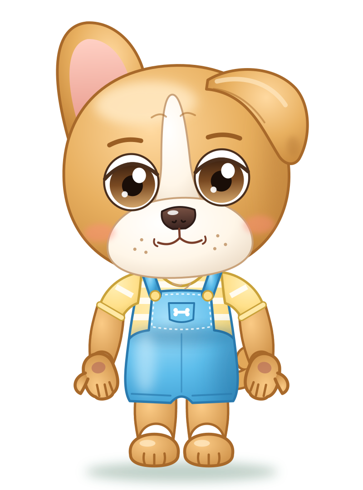
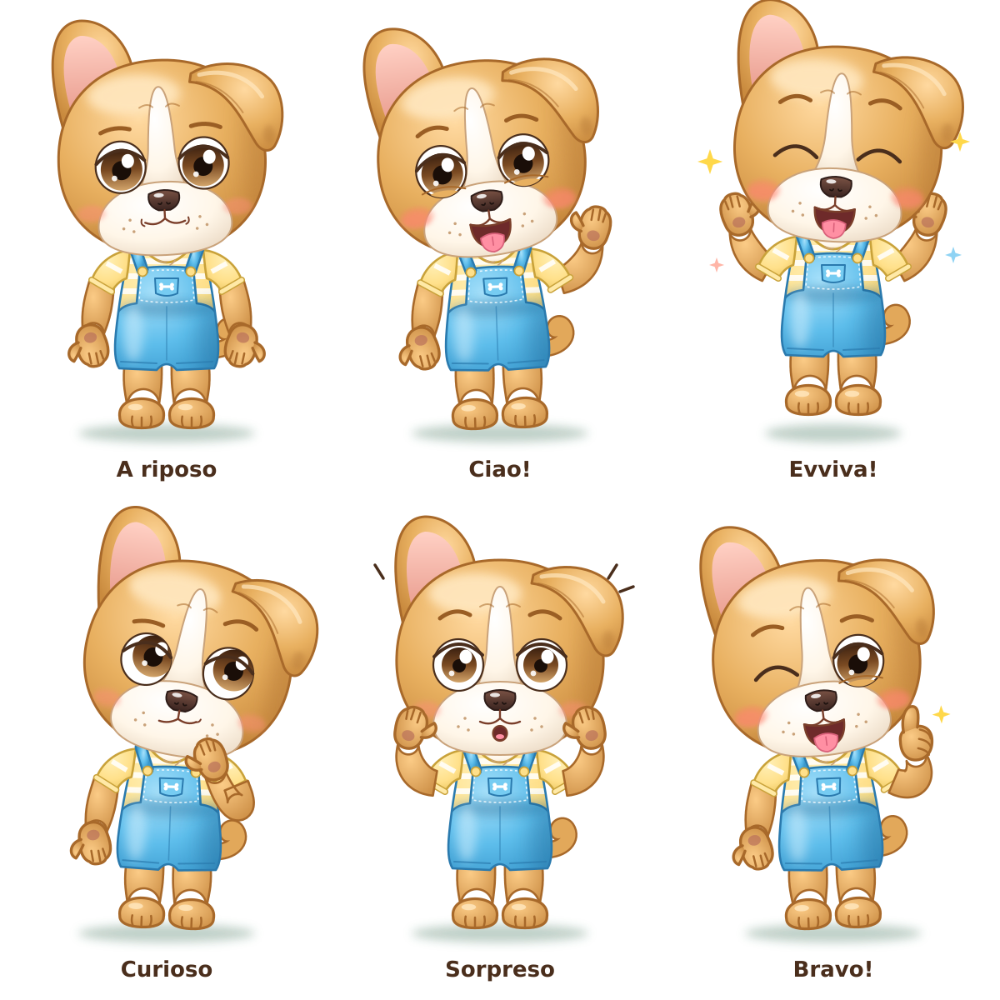

# Rio — character sheet

> Draft provisionally approved on 2026-11-12. To be refined later.

| | |
|---|---|
| **Species and role** | Honey-colored French bulldog, Elide's four-legged friend. He stands on two legs and is built like Elide. |
| **Main color** | Honey with amber shadows; dark honey outlines (`#A8692A`). |
| **White patches** | A white blaze running from the forehead down to the muzzle, a wide white muzzle, a white chest patch (visible in the T-shirt neckline). Everything else is honey. |
| **Head** | Round and full, two small wrinkles on the forehead. |
| **Ears** | **Asymmetric, this is his trademark**: **Rio's right ear** (the viewer's left) is bat-like, upright and round, with a pink inside; **Rio's left ear** (the viewer's right) is soft and folds down on the side of the head. |
| **Eyes** | Hazel, round and set wide apart; iris dark at the top and light at the bottom; thick upper eyelid, **no eyelashes**; dark honey eyebrows. |
| **Muzzle** | Wide and white, big dark shiny nose, bulldog "W"-shaped upper lip, whisker dots, rosy cheeks. When he laughs he sticks out his little pink tongue. |
| **Tail** | Short and curly. |
| **Limbs** | Chubby arms, little hands with a thumb, three fingers and a dark pink pad; full legs, feet with toes. All honey. |
| **Clothing** | Sky-blue short overalls: bib with dashed seams, small pocket with an embroidered white bone, straps with yellow buttons. Underneath, a short-sleeved T-shirt with butter-yellow and white stripes. Barefoot. |
| **Recognizable by** | Mismatched ears, white blaze on the forehead, sky-blue overalls, tongue out. |

> Convention: **right and left are always meant from the character's point of view**.

## Palette

| Use | Color |
|-----|-------|
| Fur light / base / shadow | `#FFD9A0` / `#E8B060` / `#C98A3E` |
| Fur outline | `#A8692A` |
| White patches light / base / shadow | `#FFFFFF` / `#FFF6E8` / `#EAD9C4` |
| White patches outline | `#C9A27A` |
| Iris (top → bottom) | `#3A2010` → `#7A4A22` → `#D2A46A` |
| Nose | `#7A5244` → `#3A2420` |
| Overalls light / base / shadow | `#A6E0FA` / `#5DBDEB` / `#3A98CC` |
| Overalls outline | `#2A7AAE` |
| T-shirt light / base / shadow | `#FFF0B8` / `#FFE08A` / `#E8C25A` |
| T-shirt outline | `#C9A23A` |
| Inner ear | `#FFD0C4` → `#E89A8C` |

## Poses and expressions

Idle · Hi! · Hooray! · Curious · Surprised · Well done!
