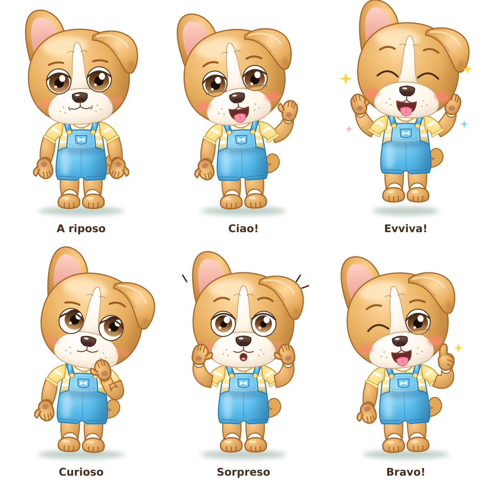

# Rio — scheda personaggio

> Bozza approvata provvisoriamente il 2026-11-12. Da ottimizzare in seguito.

| | |
|---|---|
| **Specie e ruolo** | Bulldog francese color miele, l'amico a quattro zampe di Elide. Sta in piedi su due zampe, con la stessa costruzione di Elide. |
| **Colore dominante** | Miele con ombre ambrate; contorni miele scuro (`#A8692A`). |
| **Macchie bianche** | Striscia bianca che scende dalla fronte fino al musetto, musetto bianco largo, macchia bianca sul petto (visibile nello scollo della maglietta). Il resto è miele. |
| **Testa** | Rotonda e piena, due rughette sulla fronte. |
| **Orecchie** | **Asimmetriche, è la sua caratteristica**: l'orecchio **destro di Rio** (a sinistra di chi guarda) è a pipistrello, dritto e tondo, con l'interno rosa; l'orecchio **sinistro di Rio** (a destra di chi guarda) è morbido e ricade piegato sul lato della testa. |
| **Occhi** | Nocciola, rotondi e distanziati; iride scura in alto e chiara in basso; palpebra spessa, **niente ciglia**; sopracciglia miele scuro. |
| **Musetto** | Largo e bianco, nasone scuro e lucido, labbro superiore a "W" da bulldog, puntini dei baffi, guance rosate. Quando ride tira fuori la linguetta rosa. |
| **Coda** | Corta e arricciata. |
| **Arti** | Braccia paffute, manine con pollice e tre ditine e cuscinetto rosa scuro; gambe piene, piedi con le dita. Tutto miele. |
| **Abbigliamento** | Salopette blu cielo a pantaloncini: pettorina con cuciture tratteggiate, taschino con ossicino bianco ricamato, bretelle con bottoni gialli. Sotto, maglietta a maniche corte a righe giallo burro e bianche. A piedi nudi. |
| **Riconoscibile da** | Orecchie diverse, striscia bianca sulla fronte, salopette blu cielo, linguetta fuori. |

> Convenzione: **destra e sinistra si intendono sempre dal punto di vista del personaggio**.

## Palette

| Uso | Colore |
|-----|--------|
| Pelo luce / base / ombra | `#FFD9A0` / `#E8B060` / `#C98A3E` |
| Contorno pelo | `#A8692A` |
| Macchie bianche luce / base / ombra | `#FFFFFF` / `#FFF6E8` / `#EAD9C4` |
| Contorno macchie bianche | `#C9A27A` |
| Iride (alto → basso) | `#3A2010` → `#7A4A22` → `#D2A46A` |
| Naso | `#7A5244` → `#3A2420` |
| Salopette luce / base / ombra | `#A6E0FA` / `#5DBDEB` / `#3A98CC` |
| Contorno salopette | `#2A7AAE` |
| Maglietta luce / base / ombra | `#FFF0B8` / `#FFE08A` / `#E8C25A` |
| Contorno maglietta | `#C9A23A` |
| Interno orecchio | `#FFD0C4` → `#E89A8C` |

## Pose ed espressioni

A riposo · Ciao! · Evviva! · Curioso · Sorpreso · Bravo!
